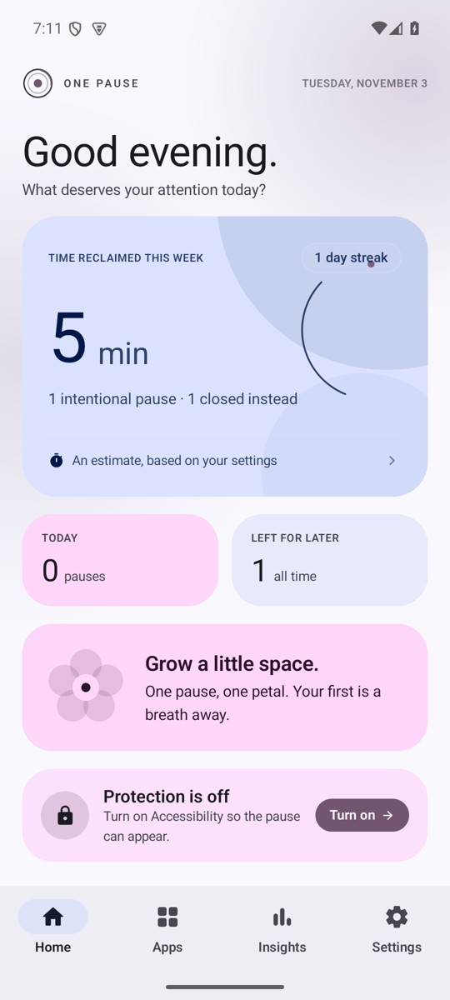
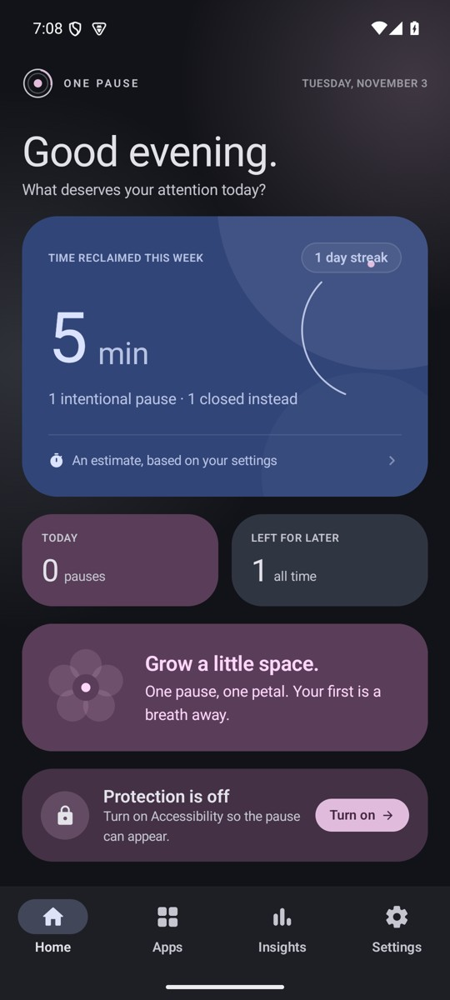
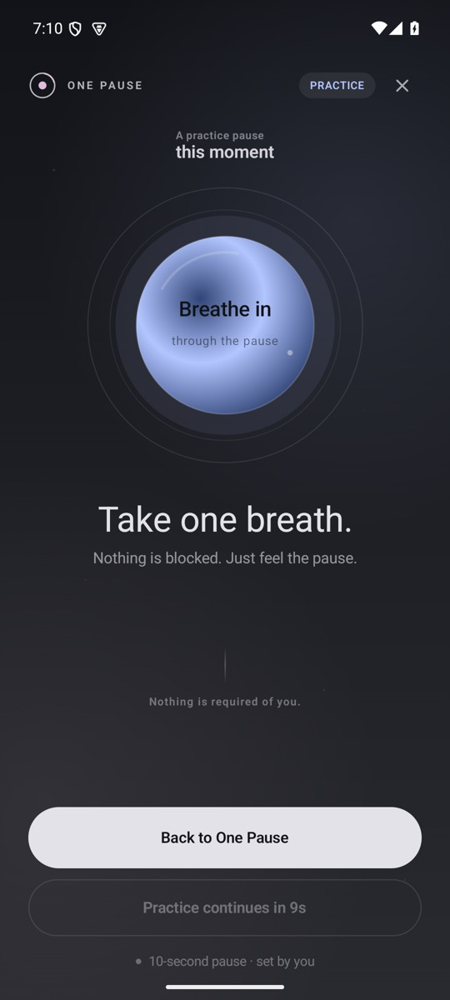

# One Pause

**One deliberate breath between you and the apps that pull you in.**

One Pause is an independent, local-first Android app that adds a short breathing pause before selected distracting apps open. It does not lock you out. It gives you a moment to notice the reflex, then decide whether to continue or leave the app for later.



## What it does

- Protects the apps you choose, using Android's Accessibility service.
- Shows a full-screen breathing pause when a protected app comes to the foreground.
- Lets you **close the app** or **open it anyway** after the pause.
- Tracks pauses, avoided sessions, and a configurable estimate of time reclaimed.
- Shows patterns by day and by app in a local-only insights screen.
- Keeps all settings and history on the device. No account, no network permission, no analytics.

## Screenshots

| Light mode | Dark mode | The pause |
| --- | --- | --- |
|  |  |  |

Colors vary with your wallpaper. Screenshots captured on an Android emulator.
Licenses remain available inside **Settings → Licenses & notices**.

## How it works

1. **You choose the apps.** One Pause lists launchable apps on the device and lets you protect any of them.
2. **Accessibility notices a launch.** The service listens only for foreground window changes and compares the package name with your protected list.
3. **A breathing overlay appears.** The pause is drawn with `TYPE_ACCESSIBILITY_OVERLAY`, so it can appear over the target app without the draw-over-other-apps permission.
4. **You decide.** Choose **Not now** to close the app and return home, or wait for the pause to finish and choose **Open anyway**.
5. **The pause steps aside.** After a decision, One Pause records the moment locally and applies a short cooldown so the overlay does not immediately reappear.

Pressing Home or Back while the pause is visible also counts as leaving the app for now. A 90-second safety timeout prevents the overlay from becoming stuck.

## Features

- **Breathing pause** with animated inhale/exhale phases and optional haptics.
- **Adjustable pause length** from 5 to 20 seconds.
- **Per-session cooldown** after a decision (60 seconds after continuing, 4 seconds after leaving).
- **Time reclaimed** based on your own estimate of 3, 5, or 10 minutes per avoided session. It is explicitly labelled as an estimate.
- **Insights** with totals, a seven-day chart, per-app breakdown, and a weekly reflection.
- **Protected-app search and filters**, with suggested popular apps highlighted.
- **Erase history** without changing your protected apps or preferences.
- **In-app licenses** for the typeface and open-source dependencies.
- **Pixel-inspired Material You design** with wallpaper-derived colors on Android 12+, automatic light/dark mode, native Material navigation, and system sans-serif typography.
- **Daily bloom**: grow one petal per intentional pause, up to five each day. Progress comes from existing on-device history.
- **Wallpaper-tinted breathing screen** with a calm dark palette and existing optional haptics.

### Smoother pauses & Pause Pal (1.2.0)

- A 320 ms entrance fade and gentle settling motion lead into the first breath. Breathing, labels, and haptics start together. The orb reads animation progress during drawing to avoid recomposing the whole screen every frame.
- Dismissal fades out over 180 ms. Choosing **Not now** brings Home forward before removing the overlay, reducing the flash of the protected app. Countdown uses monotonic elapsed time. Reduced-motion mode keeps timing and text cues without the expanding orb.
- **Settings → Uninstall guard** offers an optional Android Device Admin deactivation step. It requests no wipe, lock, or password policies. Enable accessibility protection first, then approve Android's separate consent screen. Turn accessibility protection off to release it; you can also deactivate it directly under Android **Device admin apps**. This is extra friction, not a permanent uninstall block. Android's strict uninstall-block API requires managed-device privileges that a normal APK does not have.
- The original **Pause Pal** sprout mascot replaces the launcher icon, with a matching monochrome version for Pixel themed icons.

### Pixel refresh (1.1.0)

Colors follow **Settings → Wallpaper & style**, and the main screens follow the system dark theme. Older Android versions use the bundled fallback palette. The breathing screen intentionally stays dark. Dynamic color uses Android's [Material 3 color APIs](https://developer.android.com/develop/ui/compose/designsystems/material3); no wallpaper or photo permission is needed.

Install `OnePause-v1.2.0.apk` over your existing copy to retain settings and history, provided both copies use the same signing key.

## Privacy

One Pause has **no internet permission**. It cannot send your data anywhere.

- No account, sign-in, ads, analytics, crash reporting, or telemetry.
- The Accessibility service requests only window-state events and sets `canRetrieveWindowContent="false"`.
- It never reads screen content, messages, passwords, or keystrokes.
- Settings and pause history are stored in local `SharedPreferences`.
- Android backup and data extraction are disabled.

Read the full [privacy policy](PRIVACY.md).

## Requirements

- Android 8.0 (API 26) or newer.
- Android 15 / API 35 is the compile and target SDK.
- Accessibility access must be enabled for app protection to work.
- The project builds with JDK 17, Gradle 8.9, and Android Gradle Plugin 8.7.3.

## Build

1. Install JDK 17 and the Android SDK with API 35 build tools.
2. Point Gradle at the SDK with `ANDROID_HOME` / `ANDROID_SDK_ROOT`, or create a local `local.properties` file:
   ```properties
   sdk.dir=/path/to/Android/Sdk
   ```
3. Build a debug APK:
   ```bash
   ./gradlew assembleDebug
   ```
   On Windows:
   ```powershell
   .\gradlew.bat assembleDebug
   ```
4. Install it on a connected device or emulator:
   ```bash
   adb install -r app/build/outputs/apk/debug/app-debug.apk
   ```
5. Open One Pause, complete onboarding, and enable **One Pause app protection** in Android Accessibility settings.

### Release signing

Release builds use a local keystore configured in `keystore.properties` at the repository root:

```properties
storeFile=keystore/onepause-release.jks
storePassword=...
keyAlias=onepause
keyPassword=...
```

`keystore.properties` and the `.jks` file are ignored by Git and must not be committed. If `keystore.properties` is absent, the release build falls back to debug signing so local builds stay installable.

Build and locate the release APK:

```bash
./gradlew assembleRelease
# app/build/outputs/apk/release/app-release.apk
```

Verify the signature:

```bash
apksigner verify --verbose app/build/outputs/apk/release/app-release.apk
```

## Tests and checks

```bash
./gradlew testDebugUnitTest
./gradlew lintDebug
```

The unit tests cover the stats calculator: pause/avoided totals, weekly buckets, streaks, reclaimed-time estimates, and app breakdowns.

## Project structure

```text
app/src/main/java/app/onepause/
├── MainActivity.kt              onboarding / shell routing
├── LicensesActivity.kt          in-app notices and full license text
├── PausePreviewActivity.kt      pause preview from the home screen
├── data/                        preferences, event log, stats calculator
├── service/                     accessibility service and Compose overlay
├── ui/                          home, apps, insights, settings, pause, onboarding
└── util/                        app catalog, accessibility helpers, formatting
```

## Limitations

- **Apps only, not websites.** One Pause protects Android apps by package name. It does not inspect browser URLs or block domains. Website-level protection would require a browser integration, a VPN/DNS service, or an accessibility-based URL reader, each with different privacy trade-offs.
- **Accessibility must stay enabled.** Some device manufacturers aggressively stop background or accessibility services. If protection stops, reopen One Pause and check the status card.
- **Reclaimed time is an estimate.** It is not measured screen time; it uses the per-session value you choose.
- **No hard blocking.** The pause is friction, not a lock. After the countdown you can still choose to continue.
- **Portrait only.** The app and overlay are locked to portrait for consistent phone behavior.
- **Local app list only.** Only launchable apps are listed; system components and launchers are intentionally excluded.

## Licenses and notices

One Pause is an independent project and is not affiliated with One Sec or with any of the apps it helps you pause. DM Serif Display is used under the SIL Open Font License 1.1. AndroidX, Jetpack Compose, Material 3, Kotlin, and kotlinx.coroutines are used under the Apache License 2.0.

See [THIRD_PARTY_NOTICES.md](THIRD_PARTY_NOTICES.md) for details and the in-app **Licenses & notices** screen for the full texts.
